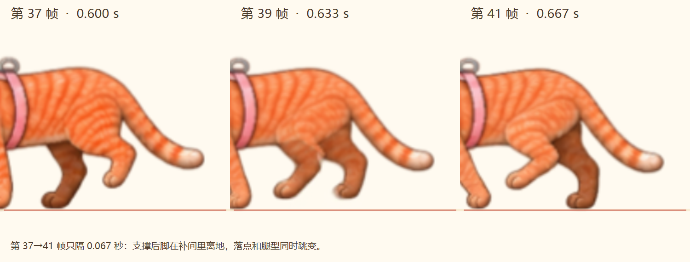

# 行走自检：未通过

检查对象：`60f45c6` 的行走小样。已在实际播放器核对正常播放、0.35 倍慢放，以及原始关键图和补间帧。

- **第 37→41 帧（0.600→0.667 秒）**：远侧后脚在两端画面踩地，中间却被补间抬起；两只后脚同时悬空，随后支撑脚落点跳变。近侧后腿的腿型也突然从后垂变为前伸。
- **原始关键姿势的时间分布不对**：第 3/4、5/6、11/12 等相邻关键图的后腿姿势很接近，而第 10→11 张变化集中。均匀播放后形成“停住—突然摆过去”，增加补间不能校正这一点。
- **上身运动缺少配合**：当前只是按周期移动整幅画面的上部，没有画出肩、髋随支撑腿交替承重的变化，看起来仍然机械。

根源在动作母稿：这些静态生成图没有形成可靠的连续步态，补间又在交错处错误连接了两条腿。此前的“64 帧不重复、关键帧保留、60 fps”只是文件和输出检查，不能证明动作正确；上一轮据此判断已补顺，结论过早。

**本版否决，保留用于定位，不接入正式桌宠。** 下一版需要先重画连续的完整猫身动作，明确四脚身份、接地时间和轨迹，先检查无补间的动作是否成立，再处理细节与补间。
